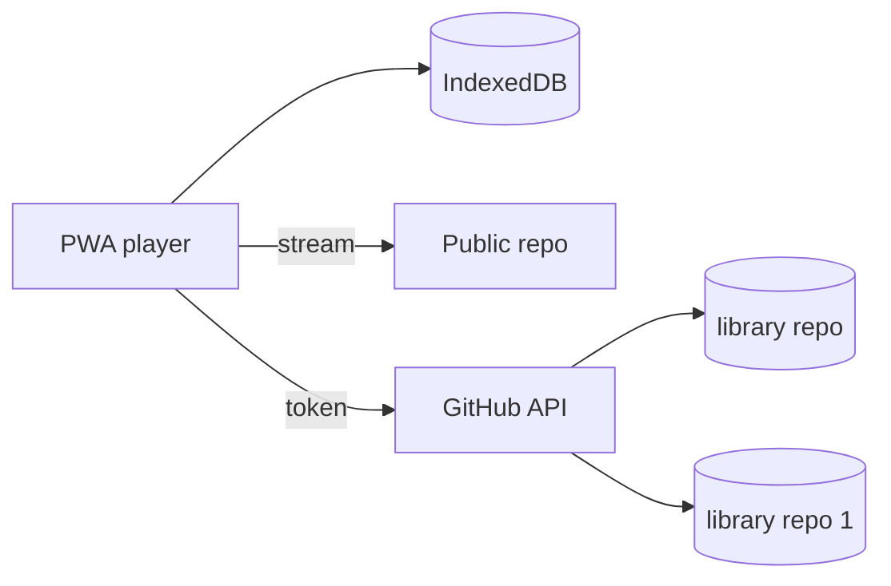
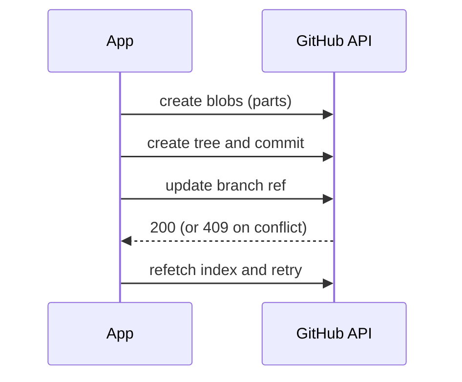
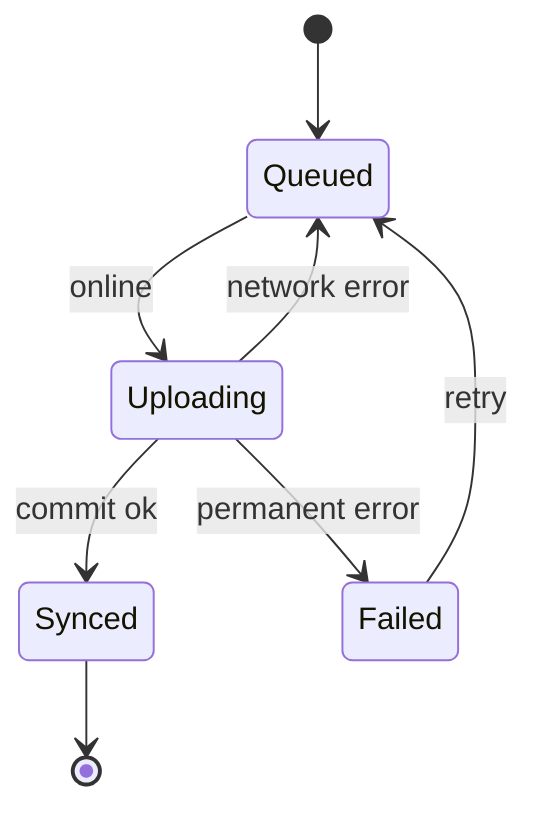
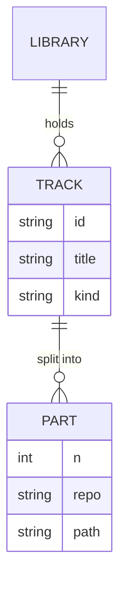

# Documentation with Mermaid

## Rule

All documentation is **Markdown**. For **architecture and design** visuals, use **Mermaid**
diagrams embedded in the Markdown (not ASCII art, not external image files).

**Always follow the `markdown-lint` skill** when writing or editing any Markdown — every
`.md` file must pass markdownlint rules (notably MD040: every code fence declares a
language; use `mermaid` for diagrams).

## When to use which diagram

| Need                                       | Mermaid diagram            |
| ------------------------------------------ | -------------------------- |
| Component architecture           | `flowchart` or `graph`     |
| Request / message flow over time           | `sequenceDiagram`          |
| Data model / entities                      | `erDiagram`                |
| state of a resource (e.g. upload lifecycle) | `stateDiagram-v2`          |
| Hosting and environments            | `flowchart` with subgraphs |
| Phases / milestones                        | `gantt` or `timeline`      |

## Conventions

- One diagram per concept; keep it readable over exhaustive.
- Use `subgraph` to group by library, repo, or environment.
- Label edges with the action/event (`push blob`, `index updated`).
- Keep node names short; explain detail in prose below the diagram.
- Always pair a diagram with a sentence or two of prose context.

## Examples

### Architecture (flowchart)

### Flow (sequenceDiagram)

### Upload lifecycle (stateDiagram)

### Data model (erDiagram)

