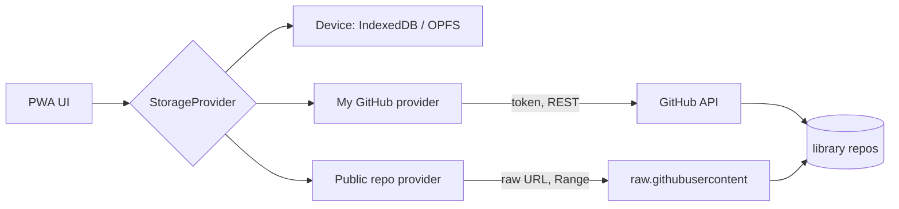
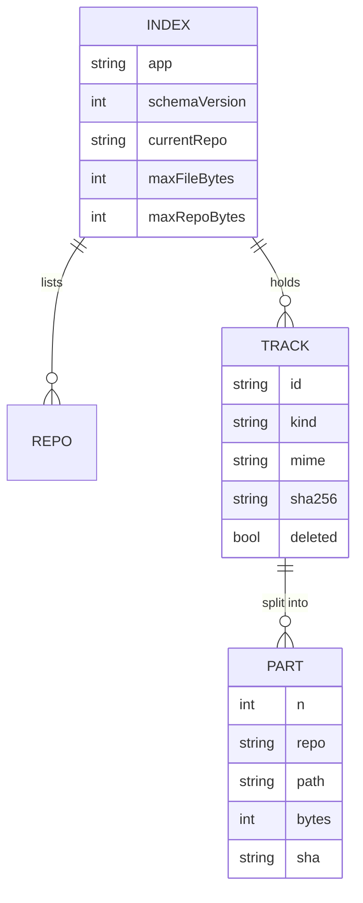
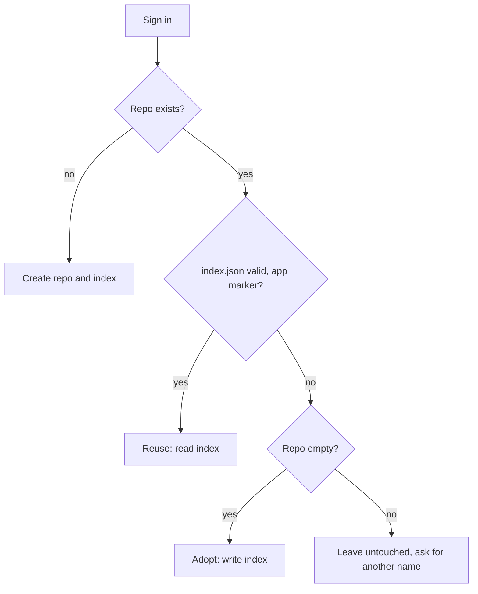
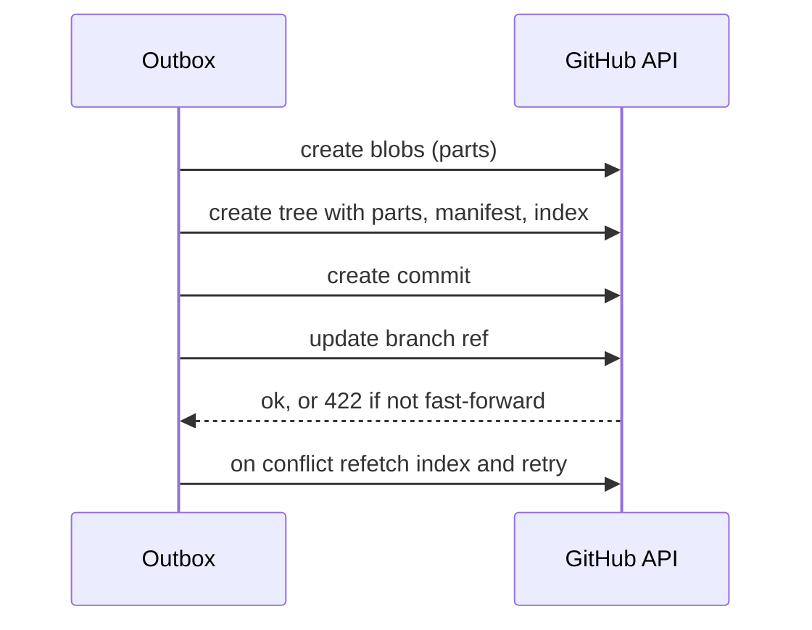
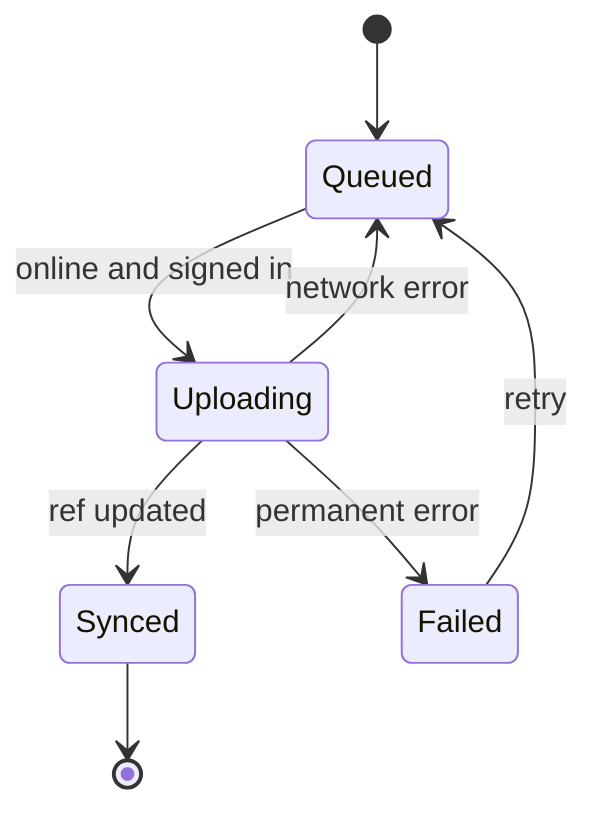

# Architecture

The app is a static, offline-first PWA. There is no backend. A track lives in one of three
libraries, and the player treats them the same through a storage interface.

## Libraries

| Library         | Sign-in | Read | Write |
| --------------- | ------- | ---- | ----- |
| Device          | No      | yes  | yes   |
| My GitHub       | Token   | yes  | yes   |
| External public | No      | yes  | no    |



The UI never calls GitHub directly. Providers hide where a track lives, so a new source
(for example OAuth login later) changes only a provider.

## Repositories and index

The primary repo is `project-music-files`. When it fills up, the app creates
`project-music-files-1`, and so on. The primary repo holds the index.

```text
project-music-files/
├── index.json        # config, repos, tracks, tombstones, followed sources
├── playlists.json    # playlists, merged per playlist by updatedAt
└── manifests/<id>.json
```



## Reusing an existing repository

On first sign-in the app looks for the library repo before creating anything. It never
overwrites or modifies a repo it did not create.



- **Valid** means `index.json` exists, carries the app marker and a known `schemaVersion`.
- A newer `schemaVersion` than the app knows opens read-only with an update prompt.
- Shard repos come from `index.repos`. If the index is missing a shard, the app finds
  `<name>-N` repos that carry the marker and offers to add them back.
- The repo name is configurable. The default is `project-music-files`.

## Size accounting

Each repo's size is counted by the app from its own uploads, because the API size lags.
Limits (50 MB per file, 800 MB per repo) are config values stored in the index.

## Upload

Files above the part size are cut into raw byte parts. Parts, manifest and index change
land in one commit through the Git Data API, so a failed upload leaves no orphans.





The outbox is persisted in IndexedDB, so a reload or a lost connection resumes the queue.

## Playback

- **Device tracks:** read from local storage and played through an object URL that the
  player creates and revokes.
- **Public, unsplit:** the raw URL is the media source. The browser streams and seeks with
  Range requests. Nothing is stored, so it is not playable offline until downloaded.
- **Missing file:** the index is refetched on open, so removed tracks drop off the list.
  A track still shown whose file returns 404 shows "File not found, unable to play".
- **Public, split:** all parts are downloaded, joined, then played. Streaming split files
  needs fragmented MP4 and is a later phase.
- **Download:** saves a local copy. When signed in, the copy is also uploaded to the user's
  repo as a new file.

## Removing the token

Settings has a "Remove token" action that works at any time, signed in or not.

- It deletes the token from local storage and clears it from memory.
- It stops the outbox and keeps queued uploads on the device, so nothing is lost. They
  resume after the next sign-in.
- Local tracks, playlists and downloaded files stay. The cached copy of the index is
  kept so the library still opens read-only offline.
- The app cannot revoke the token on GitHub. After removal it shows a link to the user's
  token settings page with a one-line instruction to delete it there.
- The token is held in one module only, so removal has a single place to clear.

## Sync

Each track has a stable id and a SHA-256. Its state is local-only, remote-only or synced.
Deletes are tombstones in the index so other devices remove the track too. Playlists sync
automatically when signed in, with a manual sync override.

## Offline

The service worker precaches the app shell. Dexie holds metadata and the local library.
The app asks the browser for persistent storage and shows usage in settings.
